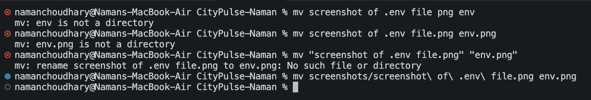
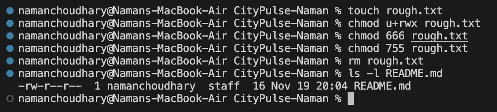
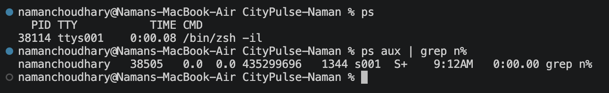
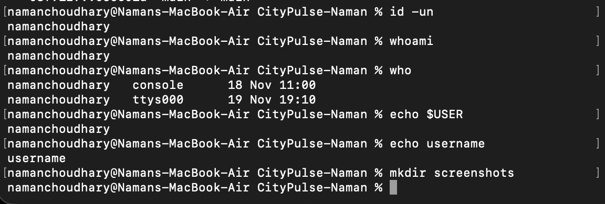
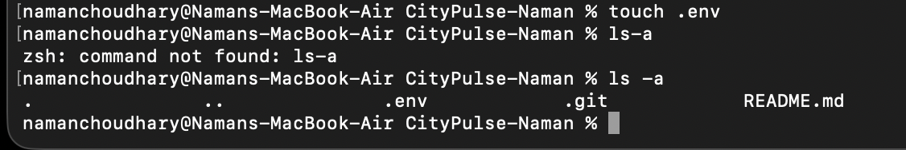

# Atria-CityPulse

This repository documents basic Linux command-line tasks and includes screenshots of the commands being run in the terminal.

## Task 1: Remove Directories

Use `mkdir` to create a directory and `rmdir` to remove an empty directory.

```bash
mkdir temp-dir
rmdir temp-dir
```

`rmdir` only works when the directory is empty. Use `rm -r` or `rm -rf` to remove directories that contain files or subdirectories.


## Task 2: Remove Files and Directories Recursively

Use `rm` to remove a file and `rm -r` or `rm -rf` to remove a directory and everything inside it.


## Task 3: Rename Files and Check Disk Usage

### Rename a File or Directory

The `mv` command renames a file or directory:

```bash
mv old-name new-name
```



### Check Disk Usage

Use `df -h` to view available and used disk space in a human-readable format:

```bash
df -h
```


## Task 4: Linux Permissions

Linux files and directories have three permission types:

| Permission | Symbol | Meaning |
| --- | --- | --- |
| Read | `r` | View file contents or list directory contents |
| Write | `w` | Modify a file or change directory contents |
| Execute | `x` | Run a file as a program or enter a directory |

Permissions are assigned to:

- The file owner
- The owner's group
- Other users

```bash
touch rough.txt
chmod u+rwx rough.txt
chmod 666 rough.txt
chmod 755 rough.txt
rm rough.txt
```



## Task 5: List Running Processes

Use `ps` to view processes for the current terminal:

```bash
ps
```

Use `ps aux` to list processes from the entire system:

```bash
ps aux
```

To search for a specific process:

```bash
ps aux | grep process-name
```

An alternative, interactive process viewer is:

```bash
top
```

Press `q` to exit `top`.



## Task 6: Check the Current User

Use `id -un`, `whoami`, or `who` to identify the current user:

```bash
id -un
whoami
who
```



## Task 7: Create and View a File

Use `touch` to create an empty file, `nano` to open a file in a text editor, and `cat` to print a file's contents:

```bash
touch .env
nano README.md
cat README.md
```



